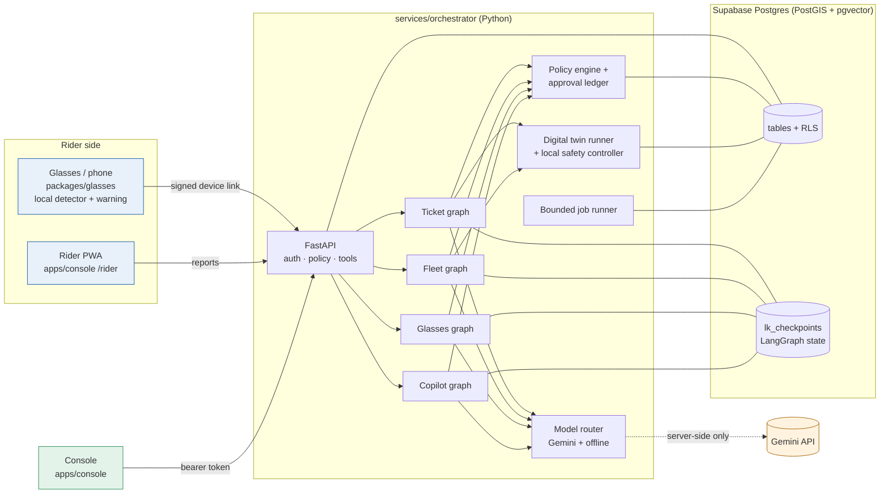

# Architecture

LaneKeeper OS has three participants: riders (phone app, simulated smart glasses), municipal staff (console) and simulated LK-01 robots. They meet in one Postgres-backed system. Agents propose, humans authorise, a simulator executes, and independent verification decides what is published.

## Components

| Component | Path | Responsibility |
|---|---|---|
| Console, rider PWA, glasses simulator, public reports | `apps/console` | React + TS + Vite, MapLibre (keyless OpenFreeMap basemap with offline fallback), three.js twin using the original LK-01 parametric model from `apps/site` |
| Smart-glasses package | `packages/glasses` | `SmartGlassesAdapter` contract; simulated and vendor-neutral Microlumin adapters; on-device detector, debounce, warning policy, offline queue, signed device link |
| Orchestrator | `services/orchestrator/lanekeeper` | LangGraph graphs, policy engine, approval ledger, model router, tools, planner, simulator, jobs, API, CLI |
| Database | `supabase/migrations` | Original six migrations unchanged, plus eleven additive LaneKeeper 2.0 migrations |
| Original site | `apps/site` | Unchanged LaneKeeper marketing site, 3D model, cost estimator |

## Graphs

Generated diagrams: [ticket](graphs/ticket.md) · [fleet](graphs/fleet.md) · [glasses](graphs/glasses.md) · [copilot](graphs/copilot.md).

| Graph | Nodes / edges | Interrupts | What it does |
|---|---|---|---|
| Ticket | 28 nodes, 44 edges (23 conditional) | `request_clarification` (evidence), `human_approval_interrupt` (dispatch), `await_safety_resolution` (twin pause) | Intake → verification → dedupe → priority → routing; the robotic branch runs approval → gateway → twin → verification → close or reopen |
| Fleet | 14 nodes | `human_approval_interrupt` (one approval per mission), `operator_review` | Nightly planning for all open robot work orders |
| Glasses | 11 nodes | none | Server side of a glasses report; the warning already happened on the device |
| Copilot | 4 nodes | none | Validated tool plan → least-privilege tools → cited answer; session memory in checkpoints |

**State.** `LaneKeeperState` (`graphs/state.py`) is versioned (`workflow_version`, `state_version`). Every inbound event is validated by Pydantic (`InboundReport`). Identity fields are outputs of server verification, never inputs.

**Checkpoints.** `PostgresSaver` lives in the private `lk_checkpoints` schema. Thread IDs are `<tenant>:<workflow>:<resource>`, bounded to 200 characters. Durable state is written before an interrupt returns, so a request handler can exit and a new process can resume the thread with `Command(resume=…)`. `test_interrupt_survives_process_restart` proves this.

**Restart safety.** LangGraph re-runs an interrupted node from the top. Interrupt nodes therefore perform no writes before `interrupt()`, and every write that precedes one is idempotent (approval requests are reused by proposal and payload hash; tickets by `ticket:<incident>`).

## Agents and ownership

| Agent | Module | Model use | Deterministic gate |
|---|---|---|---|
| Intake | `agents/intake.py` | none | schema, consent, device trust, guest rate limit, idempotency |
| Optical Intelligence | `agents/optical.py` | Decision 1 (`noul`/`choice`/`score`), Robotics ER 2 localisation | outputs are advisory |
| Geospatial | `agents/geo.py` | none | PostGIS match, no snapping beyond 75 m, boundary/accuracy review |
| Duplicate Detection | `agents/dedupe.py` | Embedding 2 (768-d) | rule score threshold + feature flag |
| Severity / Priority | `agents/severity.py` | none | municipal rubric, visible `priority_basis`, policy router |
| Municipal Ticket | `agents/tickets.py` | Flash-Lite summary | SLA, department ownership, outbox |
| Dispatch Planning | `agents/dispatch.py`, `planning/routes.py` | Hydrogen explains trade-offs only | planner + constraints + approval + gateway |
| Fleet Supervisor | `graphs/fleet.py`, `sim/runner.py` | none | local safety controller |
| Robot Inspection | `agents/inspection.py` | Robotics ER 2 + Decision 1 on the after-frame | "cleared" requires after-evidence (DB check) |
| Rider Assistance | `packages/glasses` (`RiderReportAgent`), `graphs/glasses.py`, `rider_assist.py` | none on the device | debounce + conservative warning policy; auto-drafts reports (snapshots, GPS fix, filled form) that are sent **only after the rider approves** (one glasses-button press, or a tap once stopped); drafts expire in 15 min; the server and a DB check reject agent reports without a timely rider approval |
| Municipal Knowledge | `knowledge.py` | Embedding 2 | approved, unexpired, tenant-filtered docs only |
| Analytics & Reliability | `tools/read_tools.py` `export_aggregate_metrics` | none | aggregates with denominators |

## Data model (by domain)

Tenancy (`jurisdictions`, `departments`, `district_boundaries`, `municipal_memberships`, `role_permissions`) · geography (original `lane_segments`/`lane_cells` plus `lane_cell_status`, `depots`, `closures`, `restricted_zones`) · evidence (`hazard_reports`, `report_media`, `report_consent`, `source_devices`) · cases (`hazard_incidents`, `incident_report_links`, `tickets`, `ticket_events`, `assignments`, `sla_policies`) · agents (`agent_runs`, `agent_events`, `tool_invocations`, `approval_requests`, `policy_versions`) · fleet (`robots`, `robot_capabilities`, `robot_status`, `robot_telemetry`, `robot_faults`) · missions (`mission_proposals`, `missions`, `mission_stops`, `mission_events`, `work_orders`) · verification (`inspection_evidence`, `remediation_verdicts`, `public_run_reports`) · knowledge (`knowledge_documents`, `knowledge_chunks`, `incident_embeddings`, `memory_entries`) · operations (`jobs`, `job_attempts`, `notification_outbox`, `audit_log`, `usage_counters`, `feature_flags`, `model_calls`).

## Storage and worker split

| Concern | Where | Why |
|---|---|---|
| Canonical state, RLS, audit | Postgres (Supabase) | single source of truth |
| Graph state | `lk_checkpoints` (Postgres) | survives restarts; never exposed to clients |
| Evidence images | Local content-addressed store (dev) / Supabase Storage `evidence` bucket (hosted) | private, signed URLs (120 s) |
| Execution | short request handlers + `lanekeeper worker` (leased jobs) | no fictional always-on agent; no transaction held during model calls |
| Model calls | server only | keys never reach browsers or devices |

## Device boundaries

- **Glasses / phone:** detection, debounce and warning run locally and work offline. The device holds only its pairing key and signs requests (HMAC over timestamp and body hash).
- **Robots:** `SimulatedRobotAdapter` is the only executor. `HardwareRobotAdapter` refuses at construction. The DB refuses missions on non-simulated robots or without a consumed approval. See [ROBOT_SAFETY_BOUNDARY.md](ROBOT_SAFETY_BOUNDARY.md).

## MongoDB workshop mapping

See [SOURCE_AUDIT.md](SOURCE_AUDIT.md#3-mongodb-genai-devday-notebooks). In short, the workshop's `approved: bool` became a signed, payload-bound, single-use approval ledger. MongoDB collections and vector search became Postgres tables and pgvector, and the MCP database tools became fourteen typed, least-privilege tools.
